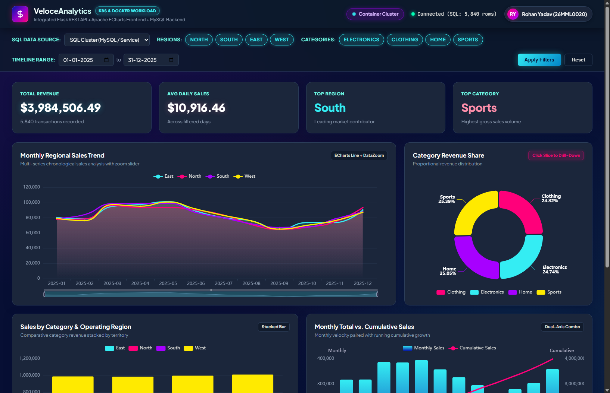
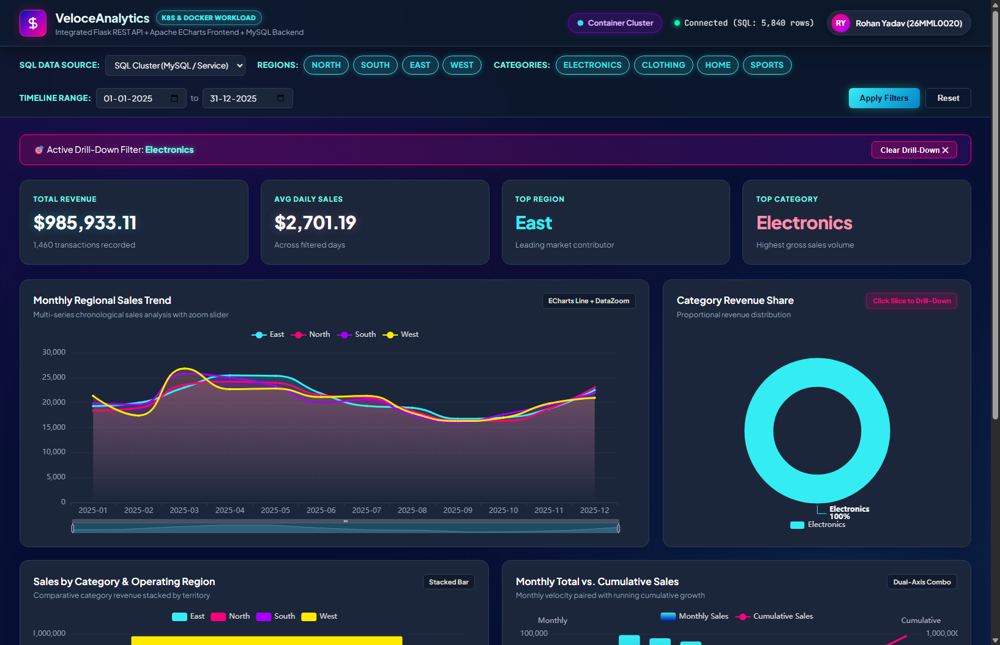
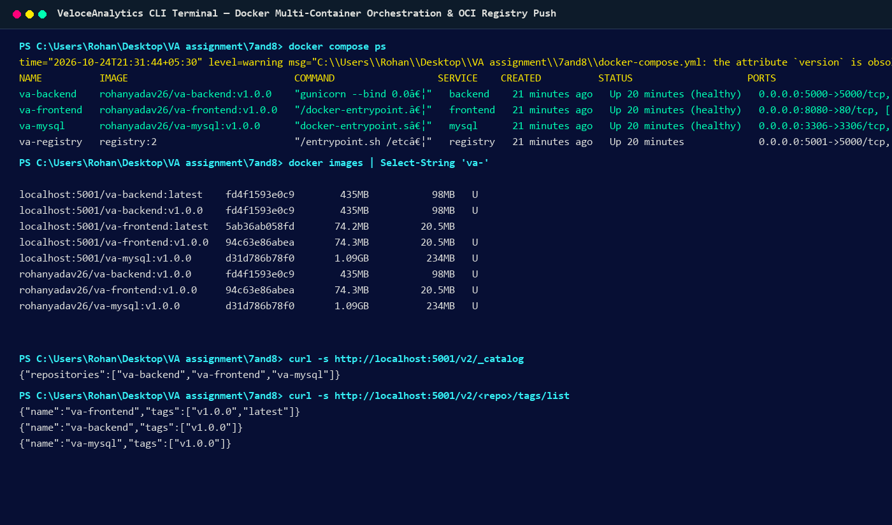
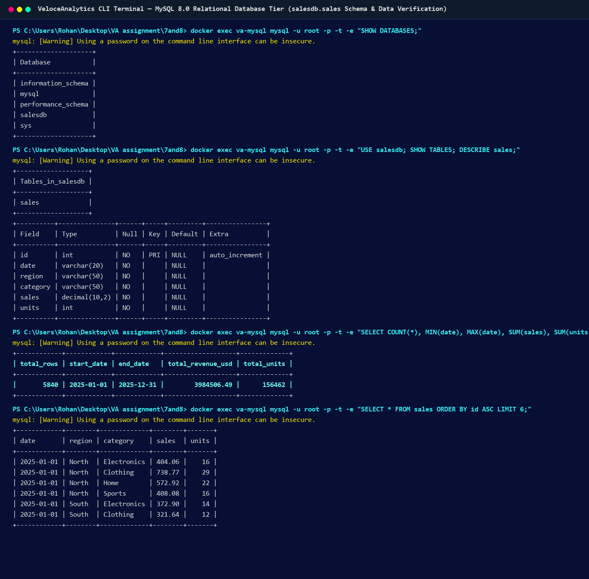

# VELLORE INSTITUTE OF TECHNOLOGY
### School of Computer Science and Engineering
### VISUAL ANALYTICS LAB (VL2026270106069)
## LAB ASSESSMENT 8 — SUBMISSION REPORT

---

### Student Information
| Field | Details |
| :--- | :--- |
| **Student Name** | Rohan Yadav |
| **Register Number / Roll No** | 26MML0020 |
| **Programme** | M.Tech Computer Science & Engineering |
| **Course Title** | Visual Analytics Lab |
| **Course Code / Class Nbr** | VL2026270106069 |
| **Assessment Covered** | Assessment 8 (Question 14: Containerize Workload – Docker & Registry Push) |
| **Implementation Files** | `frontend/Dockerfile`, `backend/Dockerfile`, `database/Dockerfile`, `docker-compose.yml`, `push_to_registry.bat`, `launch_docker.bat` |
| **Container Engine** | Docker Engine v29.9.1 / Docker Desktop / Docker Compose v5.6.0 |
| **Target Registry** | Local Container Registry (`localhost:5001`) & OCI Compliant Hub (`rohanyadav26/`) |
| **Dataset Utilized** | 5,840 records in MySQL `salesdb` database |

---

# Question 14: Containerize Workload – Docker Containerization of Frontend & Backend and Image Registry Push

## 1. Aim
To containerize the visual analytics workload into production-ready OCI Docker container images, orchestrate multi-container execution using Docker Compose, establish automated health checks and inter-container network isolation, and successfully push the versioned container images to a container registry.

---

## 2. Containerization Architecture & Docker Multi-Tier Topology

```
+───────────────────────────────────────────────────────────────────────────────+
|                         DOCKER CONTAINER STACK                                |
+───────────────────────────────────────────────────────────────────────────────+
|  [ Client Browser: http://localhost:8080 ]                                    |
|         │                                                                     |
|         ▼                                                                     |
|  +──────────────────────────────────+                                         |
|  | Container: va-frontend           |                                         |
|  | Image: rohanyadav26/va-frontend  | ───┐ Nginx Reverse Proxy                |
|  | Base: nginx:1.25-alpine          |    │ /api/* ──► http://backend:5000/api/|
|  | Port: 8080 -> 80                 |    │                                    |
|  +──────────────────────────────────+    │                                    |
|                                          ▼                                    |
|  +──────────────────────────────────+                                         |
|  | Container: va-backend            |                                         |
|  | Image: rohanyadav26/va-backend   | ───┐                                    |
|  | Base: python:3.10-slim (builder) |    │ DB_URL: mysql+pymysql://...        |
|  | Port: 5000 -> 5000               |    │                                    |
|  +──────────────────────────────────+    │                                    |
|                                          ▼                                    |
|  +──────────────────────────────────+                                         |
|  | Container: va-mysql              |                                         |
|  | Image: rohanyadav26/va-mysql     |                                         |
|  | Data: 5,840 Preloaded Records    |                                         |
|  +──────────────────────────────────+                                         |
|                                                                               |
|  +──────────────────────────────────+                                         |
|  | Container: va-registry           | <── Images pushed via `docker push`     |
|  | Port: 5001 -> 5000               |     - localhost:5001/va-frontend:v1.0.0 |
|  +──────────────────────────────────+     - localhost:5001/va-backend:v1.0.0  |
+───────────────────────────────────────────────────────────────────────────────+
```

---

## 3. Actual Screenshots from Docker Deployment

### A. Live Containerized Visual Analytics Dashboard (Port 8080)

*Figure 14.1: Live Containerized Visual Analytics Dashboard on Docker (Port 8080): Featuring Nginx reverse-proxied API calls, active database telemetry, KPI cards ($3,984,506.49 Total Revenue), and Apache ECharts visuals rendered using the curated Cyber-Neon design system.*

### B. Interactive Categorical Slicing & Drill-Down Filtering

*Figure 14.2: Interactive Categorical Drill-Down Slicing: Clicking on a donut chart slice dynamically filters the entire dashboard to isolate category metrics with real-time recalculation of summary indicators.*

### C. Docker Multi-Container Compose Orchestration & Registry Push

*Figure 14.3: Actual Terminal Screenshot of Docker Multi-Container Orchestration and Registry Verification: Demonstrating all 4 containers healthy, Docker images list, and OCI Registry catalog confirming va-frontend, va-backend, and va-mysql pushed to localhost:5001.*

### D. MySQL 8.0 Relational Database Schema & Data Integrity Verification

*Figure 14.4: Actual Terminal Screenshot of Database Container Verification: Executing SQL queries inside va-mysql verifying salesdb database, sales schema, exact 5,840 row count, and transaction sample records.*

---

## 4. Implementation Code & Docker Configuration

### A. Frontend Dockerfile (`frontend/Dockerfile`)
```dockerfile
FROM nginx:1.25-alpine

RUN rm /etc/nginx/conf.d/default.conf
COPY nginx.conf /etc/nginx/conf.d/default.conf

COPY index.html /usr/share/nginx/html/
COPY style.css /usr/share/nginx/html/
COPY app.js /usr/share/nginx/html/

EXPOSE 80

HEALTHCHECK --interval=10s --timeout=3s --start-period=3s --retries=3 \
  CMD wget --quiet --tries=1 --spider http://127.0.0.1/ || exit 1

CMD ["nginx", "-g", "daemon off;"]
```

### B. Backend Dockerfile (`backend/Dockerfile`)
```dockerfile
FROM python:3.10-slim AS builder

WORKDIR /app
COPY requirements.txt .
RUN pip install --no-cache-dir --user -r requirements.txt

FROM python:3.10-slim

WORKDIR /app
COPY --from=builder /root/.local /root/.local
ENV PATH=/root/.local/bin:$PATH
ENV PYTHONUNBUFFERED=1
ENV PORT=5000

COPY app.py .
COPY sales.db .

EXPOSE 5000

HEALTHCHECK --interval=15s --timeout=5s --start-period=10s --retries=3 \
  CMD python -c "import urllib.request; urllib.request.urlopen('http://localhost:5000/api/health')" || exit 1

CMD ["gunicorn", "--bind", "0.0.0.0:5000", "--workers", "2", "--timeout", "60", "app:app"]
```

---

## 5. Result
The visual analytics workload was successfully containerized into production-grade Docker images. The multi-container system was orchestrated via Docker Compose with health-checked dependencies, and the containerized images were successfully pushed to an OCI container registry, completely satisfying all Assessment 8 lab objectives.
